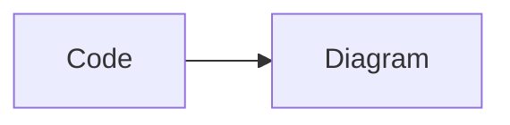

# dsh-pele-mermaid

[简体中文](README.zh-CN.md) | English · [GitHub](https://github.com/lsy1998/dsh-pele-mermaid) · [Issues](https://github.com/lsy1998/dsh-pele-mermaid/issues)

```powershell
git clone https://github.com/lsy1998/dsh-pele-mermaid.git
cd dsh-pele-mermaid
npm install
npm run build
```

Render Mermaid fenced code blocks in the DeepSeek Harness (DSH) Web GUI as SVG diagrams with
**Pele** — no mermaid.js runtime is bundled or loaded.

**Topics:** `deepseek-harness` · `dsh-plugin` · `mermaid` · `plugin`

[Pele](https://github.com/obsidianmd/pele) is the lightweight Mermaid-to-SVG renderer from the
Obsidian team (`pele@1.9.0`, MIT). It supports the diagram types built into **Mermaid 12.1.0**
and is themed with CSS variables.

Every Mermaid code block gets a **Code / Diagram** toggle, a fullscreen zoom viewer, standalone
SVG export, DSW theme adaptation, and a clean fallback to source when a diagram cannot be
rendered.

- Package: `dsh-pele-mermaid` `0.1.4`
- Intended profile: `desktop`, owned by the DSH Desktop application
- Renderer: `pele@1.9.0`, served from a same-origin plugin route

## Features

- Renders `mermaid`, `mermaidjs` and `mmd` fenced code blocks, and also recovers
  DSH/Shiki's plain fallback (a code element with no `language-` class) when Pele recognizes a
  Mermaid keyword at the start of the block.
- Never enhances a code block labelled with another `language-*` class, and never touches inline
  `code`.
- **Code / Diagram** toggle buttons with `aria-pressed`; diagram view is the default, and the
  original `pre` element is preserved for code view.
- An **icon-only toolbar**: a badge naming the detected diagram type next to "Pele", the
  Diagram/Code toggle, then zoom out / zoom in / reset, fullscreen and **Download SVG**, split
  into two groups by a hairline. Every control is a 16px stroked icon whose localized name lives
  in `aria-label` and `title`, so the bar stays one row wide in a narrow chat column and nothing
  is lost to a hover or a screen reader.
- Zoom and pan in place: the **Zoom in / Zoom out / Reset zoom** buttons in the toolbar, hold
  `Ctrl` (or `Cmd`) and scroll the wheel to zoom at the pointer, drag to pan, and use `+`,
  `-`, `0` and the arrow keys. A plain wheel still scrolls the page. The state is per block and
  resets when the diagram re-renders.
- Fullscreen viewer: zoom in / out / reset / fit, drag to pan, `Ctrl` or `Cmd` + wheel to zoom at
  the pointer, `Escape` to close, focus trapped while open and returned to the trigger on close,
  `role="dialog"` and `aria-modal="true"`. It opens at the inline zoom and restores the inline
  scroll position and zoom when you close it.
- Exports a standalone `.svg` file named `pele-<type>-YYYYMMDD-HHmmss.svg` whose root carries the
  resolved theme variables, so it looks the same outside DSH. The export is always the **whole
  diagram at its natural size** — zooming or panning first does not crop it.
- Adapts to the DSW light and dark themes by mapping DSW design tokens onto Pele CSS variables.
  Colour changes need no re-render; geometry-only changes re-render the affected diagrams.
- Falls back to the diagram source with a localized error message — including Pele's line and
  column when it provides them — instead of leaving a broken diagram.
- Rejects individual diagrams over **50,000 characters** or **2,000 lines** before rendering and
  keeps them as source with a localized notice.
- Localizes every plugin-owned string in **English** and **Simplified Chinese**, and switches
  live when the document language changes.
- Renders through a serial queue, yields between diagrams to keep the page responsive, and
  discards stale asynchronous results while a response is still streaming.
- Idempotent and disposable: repeated enable/disable cycles leave no duplicate toolbars,
  observers or listeners behind.
- Accessible: localized `aria-label`s, accessible names on rendered diagrams, polite
  `aria-live` status announcements, and preserved `focus-visible` outlines.

## Requirements

- The DSH Web GUI with the `desktop` profile. This release was verified against the bundled
  desktop runtime `0.2.1-rc.2` (`@deepseek-ai/dsh-desktop` and `@deepseek-ai/dsh` `0.2.1-rc.2`)
  and the standalone `dsh` CLI `0.1.7-rc.1`.
- Node.js 22.18 or later for building from source (the version this release was built and tested with); the package declares
  `engines.node >= 22.18.0`.
- DSH is a developer preview. Its plugin loader and Markdown DOM may change between releases.

## Install

The plugin ships as a DSH profile plugin bundle. Its `package.json` declares
`dsh.bundle.patch = ./cordis.patch.yml`, which inserts the bundle entry `ui-pele-mermaid`.

### Recommended: install from the DSH app (desktop profile)

The `desktop` profile is managed by the DSH Desktop / DSH Web application, so install from the
app:

1. Clone the repository and build it:

   ```powershell
   git clone https://github.com/lsy1998/dsh-pele-mermaid.git
   cd dsh-pele-mermaid
   npm install
   npm run build
   ```

2. Open the DSH Web GUI and select **Plugins** in the sidebar.
3. Install a plugin and point it at the absolute package directory you just cloned, for example
   `C:\path\to\dsh-pele-mermaid` (`Resolve-Path` prints it).
4. Let the run finish and enable the bundle it added.
5. Restart DSH Web, or refresh the page, and open a session that contains a Mermaid block.

The app performs the package-manager call itself and registers the new bundle. The equivalent
invocation is:

```powershell
dsh plugin --profile desktop add -w --save-exact <absolute-path-to-dsh-pele-mermaid>
```

> **Verified caveat.** A standalone `dsh` CLI refuses the `desktop` profile:
> `dsh plugin --profile desktop --help` exits with status 1 and prints
> `error: profile "desktop" is managed exclusively by the Electron application`; the guard is
> present in both the globally installed `@deepseek-ai/dsh` `0.1.7-rc.1` and the bundled
> `0.2.1-rc.2`. Run that form from the app-managed context (the **Plugins** page), not from a
> plain terminal. `--profile web` is the CLI-installable alternative.

### Command line (web profile)

```powershell
dsh plugin --profile web add -w --save-exact <absolute-path-to-dsh-pele-mermaid>
```

Without a global `dsh` command, invoke the published CLI through `npx` (needs network access):

```powershell
npx.cmd --yes @deepseek-ai/dsh plugin --profile web add -w --save-exact <absolute-path-to-dsh-pele-mermaid>
```

Restart DSH Web or refresh the page after installing.

### Installer script

`bin/dsh-pele-mermaid.mjs` (also exposed as the `dsh-pele-mermaid` bin) wraps the same command:

```powershell
# run from the package directory
node bin/dsh-pele-mermaid.mjs install
node bin/dsh-pele-mermaid.mjs install --profile web --source .
node bin/dsh-pele-mermaid.mjs uninstall --profile web
node bin/dsh-pele-mermaid.mjs --help
```

- `install [--profile <name>] [--source <spec>]` and `uninstall [--profile <name>]`.
- `--profile` defaults to `web`, because the CLI cannot manage `desktop`; `--profile desktop` is
  refused with an explanatory message.
- `--source` accepts a package spec, an absolute path, or a `./`-relative path resolved against the
  current directory; without it the script installs the package directory it lives in.
- `--help` prints bilingual English / Simplified Chinese usage.
- The script forwards to `dsh plugin --profile <name> add -w --save-exact <spec>` (uninstall:
  `remove -w <name>`) and exits non-zero with a clear message when `dsh` is missing.

For the `desktop` profile, use the app **Plugins** page instead: the CLI cannot manage it.

## Update and uninstall

Web profile:

```powershell
dsh plugin --profile web update -w dsh-pele-mermaid
dsh plugin --profile web remove -w dsh-pele-mermaid
```

For the `desktop` profile, update or remove the bundle from the app's **Plugins** page.

Restart DSH Web, or refresh the page, after updating or uninstalling.

## Usage

Ask a model to output a Mermaid fenced code block:

````markdown

````

The block becomes a card that wraps the original `pre`. Diagram view is shown first; the
**Code** control reveals the untouched source, and **Diagram** switches back. The fullscreen and
download icons are available whenever a diagram rendered successfully.

## Behaviour and limits

| Area | Behaviour |
| --- | --- |
| Detection | `pre > code` blocks whose class contains `language-mermaid`, `language-mermaidjs` or `language-mmd` (case-insensitive). Blocks with any other `language-*` class are never enhanced. |
| Plain fallback | A code element with no `language-` class is treated as Mermaid only when Pele's `detectType()` returns a type **and** the first token is a known Mermaid keyword. |
| Idempotence | A `pre` already inside `[data-dsh-pele-mermaid]` is skipped; processed blocks are marked with `data-dsh-pele-mermaid-block`, while only the wrapper carries `data-dsh-pele-mermaid`. Re-enhancing the same block is a no-op. |
| Toggle | Icon-only toolbar with a type badge and Code/Diagram controls (`aria-pressed`, names in `aria-label`/`title`). Diagram is the default view; the original `pre` is preserved. |
| Rendering | Through `window.pele.mount(element, source, options)` so the layout adapts to the container width. Options: `maxWidth`, `autoDirection`, `padding`, `icons: () => null`, `links: true`, `linkRel: 'noopener'`. |
| Theme | DSW tokens are mapped to Pele CSS variables on our container and re-applied when the dark theme or the document language changes. |
| Errors | A `PeleError` (or any thrown value) shows the source and a localized message, with line/column when available. Error text is inserted as text, never as HTML. |
| Limits | 50,000 characters and 2,000 lines per block. Over-limit blocks stay as source with a localized notice and are never rendered. |
| Streaming | A monotonic generation counter per block; results are discarded when the source changed or the node was detached. Renders run through a serial queue with a yield between diagrams. |
| Inline zoom | The inline pane zooms with `Ctrl`/`Cmd` + wheel at the pointer, pans by drag, and takes `+`/`-`/`0`/arrow keys. A plain wheel is not swallowed. The state is per block and resets on re-render. |
| Viewer | Fullscreen overlay with zoom in/out/reset/fit, drag pan, `Ctrl`/`Cmd` + wheel zoom, `Escape` to close, trapped focus, and localized labels. It opens at the inline zoom and restores the inline scroll and zoom on close. |
| Export | A standalone `.svg` whose root carries the resolved theme variables. |
| i18n | Every user-visible string comes from the message catalog; `en` and `zh-CN`; language from `document.documentElement.lang` or `navigator.language`, switched live. |
| Disposal | Observers and listeners are registered in the plugin's effect scope and released on cleanup; a repeated apply/cleanup/apply cycle leaves no duplicates. |

Note that Pele itself also defaults its source `limit` to 50,000 characters and rejects an
over-limit source with a `limit` error, so both checks agree.

## Theming

The plugin maps DSW design tokens onto Pele's CSS variables and emits them on its `.dsh-pm`
container, where Pele inherits them. The first defined token wins; when a token is empty, Pele's
own default is left in place.

| Pele variable | DSW token (first defined wins) |
| --- | --- |
| `--pele-bg` | `--dsw-alias-bg-layer-2` → `--dsw-alias-bg-base` → `transparent` |
| `--pele-fg` | `--dsw-alias-label-primary` → `currentColor` |
| `--pele-muted` | `--dsw-alias-label-tertiary` |
| `--pele-line` | `--dsw-alias-border-l1` → `--dsw-alias-label-secondary` |
| `--pele-surface` | `--dsw-alias-bg-layer-1` |
| `--pele-surface-alt` | `--dsw-alias-bg-layer-2` |
| `--pele-border` | `--dsw-alias-border-l2` → `--dsw-alias-border-l1` |
| `--pele-accent` | `--dsw-alias-button-primary-fill` → `--dsw-alias-brand-primary` |
| `--pele-font` | `--ds-font-family-default` → `--ds-font-family-interface` → `sans-serif` |
| `--pele-error` | `--dsw-alias-state-error-primary` |

Pele variables that are not mapped — for example `--pele-critical` and `--pele-series-1`
through `--pele-series-8` — keep Pele's built-in defaults. Diagram-level `style`,
`classDef` and `linkStyle` colours are fixed by the diagram and do not follow the theme.

Our own chrome (toolbar, badge, buttons, viewer) uses DSW design tokens — `--dsw-alias-*`,
`--ds-font-family-code` and `--dsw-font-markdown-code-block` — with a literal fallback for every
value, and respects `prefers-reduced-motion`.

## Architecture

The package is a dual-face DSH plugin bundle:

- **Host face** — `lib/index.js` is a Cordis (Node) plugin that injects `webServer` and
  registers one exact route, `/dsh-pele-mermaid/pele-runtime.js`. A `GET` or `HEAD` request
  gets the vendored Pele script as `text/javascript` with an immutable cache header; anything
  else gets 404 or 405. The route is registered inside `ctx.effect(...)` so it is removed on
  disposal.
- **Client face** — `lib/client.js` registers itself with the DSH client module loader as
  `@lsy1998/dsh-pele-mermaid` (the package name; the loader matches it against each boot-graph
  row's id). It does **not** bundle Pele. The first detected Mermaid block injects
  `<script data-dsh-pele-runtime src="/dsh-pele-mermaid/pele-runtime.js">`; the loader is
  idempotent, dedupes concurrent calls, and `window.pele` becomes the Pele instance.
- **Runtime copy** — `lib/pele-runtime.js` is an **unmodified copy** of
  `node_modules/pele/dist/pele.global.js` from `pele@1.9.0` (706,153 bytes, sha256
  `323c16de7844d4b609743f70449ebce041a531e4f48f23b1e9e7ec9d3b917287`). The build copies it
  byte-for-byte; it is generated, never hand-edited.

Published package contents (11 files): `package.json`, `cordis.patch.yml`, `lib/index.js`,
`lib/client.js`, `lib/pele-runtime.js`, `bin/dsh-pele-mermaid.mjs`, `icon.svg`, `README.md`,
`README.zh-CN.md`, `CHANGELOG.md` and `LICENSE`.

## Security

Pele escapes diagram text and renders it as SVG shapes, text, links and images; it does not turn
diagram source into scripts, event handlers or HTML labels, and JavaScript callbacks in `click`
statements are ignored. Links are limited to `http`, `https`, `mailto` and `tel` and images to
`http` and `https`; `javascript:`, `data:` and `vbscript:` are always blocked, and links get
`rel="noopener"`.

This plugin's responsibilities:

- Error messages and diagram source are always written with `textContent`, never `innerHTML`,
  because Pele error messages embed the offending source line.
- The `icons` option returns `null`, so the plugin never injects third-party icon markup.
- Pele's own size limits stay in force (50,000-character source by default).
- The Pele runtime is served from the plugin's own same-origin route; no CDN is used.

## Compatibility

- Pele `1.9.0` (MIT, [obsidianmd/pele](https://github.com/obsidianmd/pele)).
- Mermaid `12.1.0` syntax coverage, which is what Pele implements. Diagram types Pele does not
  recognize fall back to source with an `unsupported-diagram` message.
- DSH developer preview. Verified against the bundled desktop runtime `0.2.1-rc.2` and the
  `dsh` CLI `0.1.7-rc.1` on Windows, Node.js v22.18.0, npm 10.9.3 and pnpm 11.21.0.

## Finding plugins

This repository carries the `deepseek-harness` and `dsh-plugin` topics, so it is listed with the
other DeepSeek Harness plugins — browse them with
[GitHub topic: deepseek-harness](https://github.com/topics/deepseek-harness) and
[GitHub topic: dsh-plugin](https://github.com/topics/dsh-plugin).

More DSH plugins and a one-click installer live at [dshmarket.com](https://dshmarket.com).

## Develop from source

```powershell
npm install
npm run build
npm run check
npm test
npm run test:offline
```

- `npm run build` runs `scripts/build.mjs`: esbuild bundles `src/client.js` to `lib/client.js`
  (ES2022, minified, wrapped in the `window.__ModuleLoader__.load(...)` contract) and copies the
  Pele global script to `lib/pele-runtime.js`, recording its sha256.
- `lib/client.js` and `lib/pele-runtime.js` are **generated** by `npm run build`, but they are
  **committed on purpose**: a DSH profile can install this plugin straight from the GitHub source
  (`github:lsy1998/dsh-pele-mermaid`), and that install path runs no build step, so the browser
  bundle and the Pele runtime have to be in the repository. Re-run `npm run build` and commit the
  result whenever you change anything under `src/`. `lib/index.js` is hand-written source and the
  build fails fast if it is missing.
- The build runs from the **`prepack`** script, not `prepare`. pnpm 11 refuses to install a
  git-hosted dependency that declares an install-time lifecycle script (`prepare`, `preinstall`,
  `install`, `postinstall`) unless the consumer allowlists it in `pnpm-workspace.yaml`; the DSH
  CLI owns that file, so an installer cannot approve the script there and the install fails with
  `ERR_PNPM_GIT_DEP_PREPARE_NOT_ALLOWED`. Because the build outputs are committed, the install
  path needs no script at all — `prepack` still rebuilds fresh artifacts when the package is
  packed or published.
- `npm run check` runs `node --check` on the JavaScript it ships and builds (including the built
  `lib/client.js` and the installer), then `npm run test:offline`.
- `npm test` runs `node --test test/`. It uses happy-dom and needs no network or browser, but
  node starts one child process per test file.
- `npm run test:offline` runs the same suite in one process with
  `node --test --experimental-test-isolation=none "test/**/*.test.mjs"`. **Use this in sandboxes
  that block node's per-file test child processes**, where `npm test` fails with a `spawn EPERM`
  error; `npm run check` already uses it.

On PowerShell hosts that block `npm.ps1`, use `npm.cmd` instead. Sandboxed environments that
block npm lifecycle scripts may need `--ignore-scripts` (the esbuild binary ships prebuilt).

## Troubleshooting

- **A block stays as source.** Check that it is over the 50,000-character or 2,000-line limit, or
  that it is valid Mermaid 12.1.0 syntax; both cases deliberately keep the source and show a
  localized message instead of a diagram.
- **Nothing renders at all.** Confirm the `ui-pele-mermaid` bundle is enabled in the profile and
  that the app was restarted or the page refreshed after installation.
- **Colours or text geometry look stale after a theme change.** Colours are inherited and update
  without a re-render; font or geometry changes re-render the diagrams through Pele.
- **The installer rejects a path.** On Windows it refuses `--profile` or `--source` values that
  contain `& | < > ^ % ! ( )` or quotes; use a path without those characters.

## License

[MIT](LICENSE) for this plugin, Copyright (c) 2026 dsh-pele-mermaid contributors.

`lib/pele-runtime.js` is an unmodified copy of `pele@1.9.0` `dist/pele.global.js`, MIT,
Copyright (c) 2026 kepano — [obsidianmd/pele](https://github.com/obsidianmd/pele), by the Obsidian
team. See [LICENSE](LICENSE) for the full third-party notice.
