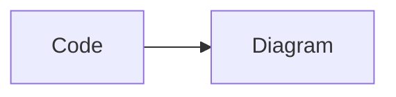

# dsh-pele-mermaid

[English](README.md) | 简体中文 · [GitHub](https://github.com/lsy1998/dsh-pele-mermaid) · [Issues](https://github.com/lsy1998/dsh-pele-mermaid/issues)

```powershell
git clone https://github.com/lsy1998/dsh-pele-mermaid.git
cd dsh-pele-mermaid
npm install
npm run build
```

在 DeepSeek Harness（DSH）Web 界面中用 **Pele** 把 Mermaid 围栏代码块渲染为 SVG 图表，
**不打包也不加载 mermaid.js 运行时**。

**标签：** `deepseek-harness` · `dsh-plugin` · `mermaid` · `plugin`

[Pele](https://github.com/obsidianmd/pele) 是 Obsidian 团队出品的轻量 Mermaid 转 SVG 渲染器
（`pele@1.9.0`，MIT）。它支持 **Mermaid 12.1.0** 内置的全部图表类型，并使用 CSS 变量适配主题。

每个 Mermaid 代码块都会获得 **代码 / 图表** 切换、全屏缩放查看器、独立 SVG 导出、DSW 主题适配，
以及渲染失败时回退到源代码的能力。

- 包名：`dsh-pele-mermaid` `0.1.4`
- 目标 profile：`desktop`，由 DSH 桌面应用管理
- 渲染器：`pele@1.9.0`，由插件自身的同源路由提供

## 功能

- 渲染 `mermaid`、`mermaidjs`、`mmd` 围栏代码块；也能识别 DSH/Shiki 的纯文本回退情形
  （code 元素没有 `language-` 类）——此时只有 Pele 的 `detectType()` 能识别类型、且首词是已知
  Mermaid 关键字才会渲染。
- 绝不处理带有其他 `language-*` 类的代码块，也绝不处理行内 `code`。
- **代码 / 图表** 切换按钮带 `aria-pressed`；默认显示图表视图，切换回代码视图时保留原始 `pre`。
- 工具栏为**纯图标**：左侧徽标显示识别出的图表类型并标注 “Pele”，随后是图表/代码切换，再以一条细分隔线
  分成两组 —— 缩小 / 放大 / 重置、全屏、**下载 SVG**。每个控件都是 16px 描边图标，本地化名称放在
  `aria-label`（无障碍名称）与 `title`（悬停提示）里，因此窄聊天列下工具栏仍保持一行，悬停与读屏也都不丢信息。
- 就地缩放与平移：工具栏上的**放大 / 缩小 / 重置缩放**按钮，按住 `Ctrl`（或 `Cmd`）滚动滚轮以指针为中心
  缩放，拖拽可平移，也可使用 `+`、`-`、`0` 与方向键。普通滚轮仍会正常滚动页面。该状态按代码块独立保存，
  图表重新渲染后重置。
- 全屏查看器：放大 / 缩小 / 重置 / 适应窗口、拖拽平移、`Ctrl` 或 `Cmd` + 滚轮以指针为中心缩放、
  `Escape` 关闭；打开时焦点被限制在对话框内，关闭后回到触发控件；使用 `role="dialog"` 与
  `aria-modal="true"`。
- 导出名为 `pele-<type>-YYYYMMDD-HHmmss.svg` 的独立 `.svg`，其根元素带有解析后的主题变量，
  离开 DSH 后外观一致。
- 把 DSW 设计令牌映射为 Pele 的 CSS 变量以适配明暗主题；颜色变化无需重新渲染，纯几何变化才重绘。
- 渲染失败时回退到图表源码并显示本地化错误信息（Pele 提供行/列时一并显示），不会留下破损图表。
- 单个图表超过 **50,000 字符** 或 **2,000 行** 时在渲染前拒绝，保留源码并显示本地化提示。
- 所有插件自带文案均有 **英文** 与 **简体中文**，并随文档语言变化实时切换。
- 通过串行队列渲染，图表之间让出主线程以保持页面响应；流式输出期间丢弃过期的异步结果。
- 幂等且可释放：反复启用/禁用不会残留重复工具栏、观察器或监听器。
- 无障碍：本地化 `aria-label`、渲染图表的可访问名称、`aria-live` 礼貌播报状态，
  并保留 `focus-visible` 焦点轮廓。

## 环境要求

- 使用 `desktop` profile 的 DSH Web 界面。本版本已在随应用分发的桌面运行时 `0.2.1-rc.2`
  （`@deepseek-ai/dsh-desktop` 与 `@deepseek-ai/dsh` `0.2.1-rc.2`）以及独立 `dsh` CLI
  `0.1.7-rc.1` 上核对。
- 从源码构建需要 Node.js 22.18 或更高版本（本版本的构建与测试环境）；包内声明 `engines.node >= 22.18.0`。
- DSH 目前是开发者预览版，其插件加载器与 Markdown DOM 可能随版本变化。

## 安装

本插件以 DSH profile 插件包（bundle）的形式发布。其 `package.json` 声明
`dsh.bundle.patch = ./cordis.patch.yml`，插入 bundle 条目 `ui-pele-mermaid`。

### 推荐：通过 DSH 应用安装（desktop profile）

`desktop` profile 由 DSH 桌面 / Web 应用管理，请从应用内安装：

1. 克隆仓库并构建：

   ```powershell
   git clone https://github.com/lsy1998/dsh-pele-mermaid.git
   cd dsh-pele-mermaid
   npm install
   npm run build
   ```

2. 打开 DSH Web 界面，在侧边栏选择 **Plugins**（插件）页面。
3. 选择安装插件，指向刚才克隆下来的绝对目录，例如 `C:\path\to\dsh-pele-mermaid`
   （可用 `Resolve-Path` 查看）。
4. 等待执行完成，并启用它新增的 bundle。
5. 重启 DSH Web 或刷新页面，然后打开包含 Mermaid 代码块的会话。

应用会自行执行包管理器调用并注册新的 bundle。等价的命令是：

```powershell
dsh plugin --profile desktop add -w --save-exact <dsh-pele-mermaid 的绝对路径>
```

> **已核实的注意事项。** 独立 `dsh` CLI 会拒绝 `desktop` profile：
> `dsh plugin --profile desktop --help` 以状态码 1 退出，并输出
> `error: profile "desktop" is managed exclusively by the Electron application`；该限制
> （`rejectElectronProfile`）同时存在于全局安装的 `@deepseek-ai/dsh` `0.1.7-rc.1` 与随应用
> 分发的 `0.2.1-rc.2` 中。请在应用管理的环境中（**Plugins** 页面）执行该形式，而不要在普通终端
> 中执行。`--profile web` 是可用 CLI 安装的替代方案。

### 命令行（web profile）

```powershell
dsh plugin --profile web add -w --save-exact <dsh-pele-mermaid 的绝对路径>
```

若没有全局 `dsh` 命令，可通过 `npx` 调用已发布的 CLI（需要网络）：

```powershell
npx.cmd --yes @deepseek-ai/dsh plugin --profile web add -w --save-exact <dsh-pele-mermaid 的绝对路径>
```

安装后请重启 DSH Web 或刷新页面。

### 安装脚本

`bin/dsh-pele-mermaid.mjs`（同时以 `dsh-pele-mermaid` 命令名提供）封装了同一条命令：

```powershell
# 在包目录下执行
node bin/dsh-pele-mermaid.mjs install
node bin/dsh-pele-mermaid.mjs install --profile web --source .
node bin/dsh-pele-mermaid.mjs uninstall --profile web
node bin/dsh-pele-mermaid.mjs --help
```

- 支持 `install [--profile <名称>] [--source <spec>]` 与 `uninstall [--profile <名称>]`。
- `--profile` 默认是 `web`，因为 CLI 无法管理 `desktop`；传入 `--profile desktop` 会被拒绝并给出
  说明。
- `--source` 接受包规格、绝对路径，或相对当前目录解析的 `./` 相对路径；不传时安装脚本自身
  所在的包目录。
- `--help` 打印英文与简体中文双语用法。
- 脚本转发为 `dsh plugin --profile <名称> add -w --save-exact <spec>`（卸载为
  `remove -w <包名>`）；找不到 `dsh` 时以非零状态退出并给出清晰提示。

`desktop` profile 请改用应用内的 **Plugins** 页面：CLI 无法管理它。

## 更新与卸载

web profile：

```powershell
dsh plugin --profile web update -w dsh-pele-mermaid
dsh plugin --profile web remove -w dsh-pele-mermaid
```

`desktop` profile 请在应用的 **Plugins** 页面更新或移除该 bundle。

更新或卸载后请重启 DSH Web 或刷新页面。

## 使用

让模型输出一个 Mermaid 围栏代码块：

````markdown

````

该代码块会变成一个包裹原始 `pre` 的卡片。默认显示图表视图；点击**代码**图标显示未改动的源码，
点击**图表**图标切回。渲染成功时，全屏与下载图标始终可用。

## 行为与限制

| 方面 | 行为 |
| --- | --- |
| 识别 | class 含 `language-mermaid`、`language-mermaidjs` 或 `language-mmd`（不区分大小写）的 `pre > code` 块。带其他 `language-*` 类的块绝不处理。 |
| 纯文本回退 | 没有 `language-` 类的 code 元素，仅当 Pele 的 `detectType()` 返回类型 **且** 首词是已知 Mermaid 关键字时才按 Mermaid 处理。 |
| 幂等 | 已在 `[data-dsh-pele-mermaid]` 内的 `pre` 会被跳过；处理过的块标记 `data-dsh-pele-mermaid-block`，仅外层容器带 `data-dsh-pele-mermaid`。重复处理同一块不会产生副作用。 |
| 切换 | 纯图标工具栏，含类型徽标与代码/图表按钮（`aria-pressed`，名称在 `aria-label`/`title`）。默认图表视图，保留原始 `pre`。 |
| 渲染 | 通过 `window.pele.mount(element, source, options)`，使布局随容器宽度自适应。选项：`maxWidth`、`autoDirection`、`padding`、`icons: () => null`、`links: true`、`linkRel: 'noopener'`。 |
| 主题 | 在插件容器上把 DSW 令牌映射为 Pele CSS 变量；暗色主题或文档语言变化时重新应用。 |
| 错误 | `PeleError`（或任何抛出的值）会显示源码与本地化信息，可用时带行列号。错误文本一律按文本插入，绝不作为 HTML。 |
| 限制 | 每块 50,000 字符、2,000 行。超限块保留源码并显示本地化提示，永不渲染。 |
| 流式 | 每块使用单调递增的代数计数器；源码变化或节点脱离时丢弃结果。渲染经串行队列，图表之间让出主线程。 |
| 就地缩放 | 工具栏提供放大 / 缩小 / 重置缩放按钮；内联面板同时支持 `Ctrl`/`Cmd` + 滚轮以指针为中心缩放、拖拽平移，以及 `+`/`-`/`0`/方向键。普通滚轮不会被拦截。状态按块独立保存，重新渲染后重置。 |
| 查看器 | 全屏浮层：放大/缩小/重置/适应窗口、拖拽平移、`Ctrl`/`Cmd` + 滚轮缩放、`Escape` 关闭、焦点锁定、标签本地化。打开时沿用内联缩放，关闭时恢复内联的滚动位置与缩放。 |
| 导出 | 独立 `.svg`，其根元素带有解析后的主题变量。导出始终是**自然尺寸下的完整图表**，事先缩放或平移不会裁剪它。 |
| 国际化 | 所有用户可见文案来自消息表；支持 `en` 与 `zh-CN`；语言取自 `document.documentElement.lang` 或 `navigator.language`，支持实时切换。 |
| 释放 | 观察器与监听器注册在插件 effect 作用域内，清理时释放；重复 apply/cleanup/apply 不产生重复。 |

另外，Pele 自身的源码 `limit` 默认也是 50,000 字符，超限时抛出 `limit` 错误，与本插件的检查一致。

## 主题

插件把 DSW 设计令牌映射为 Pele 的 CSS 变量，并输出在自己的 `.dsh-pm` 容器上，供 Pele 继承。
第一个有定义的令牌生效；令牌为空时保留 Pele 自身默认值。

| Pele 变量 | DSW 令牌（第一个有定义的生效） |
| --- | --- |
| `--pele-bg` | `--dsw-alias-bg-layer-2` → `--dsw-alias-bg-base` → `transparent` |
| `--pele-fg` | `--dsw-alias-label-primary` → `currentColor` |
| `--pele-muted` | `--dsw-alias-label-tertiary` |
| `--pele-line` | `--dsw-alias-border-l1` → `--dsw-alias-label-secondary` |
| `--pele-surface` | `--dsw-alias-bg-layer-1` |
| `--pele-surface-alt` | `--dsw-alias-bg-layer-2` |
| `--pele-border` | `--dsw-alias-border-l2` → `--dsw-alias-border-l1` |
| `--pele-accent` | `--dsw-alias-button-primary-fill` → `--dsw-alias-brand-primary` |
| `--pele-font` | `--ds-font-family-default` → `--ds-font-family-interface` → `sans-serif` |
| `--pele-error` | `--dsw-alias-state-error-primary` |

未映射的 Pele 变量（例如 `--pele-critical` 以及 `--pele-series-1` 到 `--pele-series-8`）
保留 Pele 内置默认值。图表内 `style`、`classDef`、`linkStyle` 指定的颜色由图表固定，不随主题变化。

插件自身的界面（工具栏、徽标、按钮、查看器）使用 DSW 设计令牌 —— `--dsw-alias-*`、
`--ds-font-family-code`、`--dsw-font-markdown-code-block` —— 并为每个取值提供字面量回退，
同时尊重 `prefers-reduced-motion`。

## 架构

本包是一个双面（dual-face）DSH 插件 bundle：

- **宿主面** — `lib/index.js` 是 Cordis（Node）插件，注入 `webServer` 并注册唯一的精确路由
  `/dsh-pele-mermaid/pele-runtime.js`。`GET` 或 `HEAD` 请求返回内置的 Pele 脚本，内容类型为
  `text/javascript` 并带不可变缓存头；其他情况返回 404 或 405。路由注册在 `ctx.effect(...)`
  内，释放时被移除。
- **客户端面** — `lib/client.js` 以 `@lsy1998/dsh-pele-mermaid` 注册到 DSH 客户端模块加载器。它
  **不** 打包 Pele。检测到第一个 Mermaid 块时注入
  `<script data-dsh-pele-runtime src="/dsh-pele-mermaid/pele-runtime.js">`；加载器幂等、合并并发
  调用，随后 `window.pele` 即为 Pele 实例。
- **运行时副本** — `lib/pele-runtime.js` 是 `pele@1.9.0` 的
  `node_modules/pele/dist/pele.global.js` 的 **未修改副本**（706,153 字节，sha256
  `323c16de7844d4b609743f70449ebce041a531e4f48f23b1e9e7ec9d3b917287`）。构建逐字节复制，
  该文件是生成产物，绝不手工编辑。

发布包内容（共 11 个文件）：`package.json`、`cordis.patch.yml`、`lib/index.js`、`lib/client.js`、
`lib/pele-runtime.js`、`bin/dsh-pele-mermaid.mjs`、`icon.svg`、`README.md`、`README.zh-CN.md`、
`CHANGELOG.md`、`LICENSE`。

## 安全

Pele 会转义图表文本，仅渲染为 SVG 图形、文本、链接与图片；不会把图表源码变成脚本、事件处理器或
HTML 标签，`click` 语句中的 JavaScript 回调会被忽略。链接只允许 `http`、`https`、`mailto`、
`tel`，图片只允许 `http`、`https`；`javascript:`、`data:`、`vbscript:` 一律阻止，链接带
`rel="noopener"`。

本插件承担的责任：

- 错误信息与图表源码一律用 `textContent` 写入，绝不使用 `innerHTML`，因为 Pele 的错误信息会内嵌
  出错的源码行。
- `icons` 选项返回 `null`，插件绝不注入第三方图标标记。
- Pele 自身的体积限制仍然生效（源码默认 50,000 字符）。
- Pele 运行时由插件自身的同源路由提供，不使用任何 CDN。

## 兼容性

- Pele `1.9.0`（MIT，[obsidianmd/pele](https://github.com/obsidianmd/pele)）。
- Mermaid `12.1.0` 语法覆盖范围，即 Pele 所实现的语法。Pele 不认识的图表类型会回退到源码并显示
  `unsupported-diagram` 信息。
- DSH 开发者预览版。已在 Windows、Node.js v22.18.0、npm 10.9.3、pnpm 11.21.0 环境下，对随应用
  分发的桌面运行时 `0.2.1-rc.2` 与 `dsh` CLI `0.1.7-rc.1` 进行核对。

## 发现更多插件

本仓库带有 `deepseek-harness` 与 `dsh-plugin` 标签，会和其他 DeepSeek Harness 插件一起出现在
[GitHub 话题：deepseek-harness](https://github.com/topics/deepseek-harness) 和
[GitHub 话题：dsh-plugin](https://github.com/topics/dsh-plugin) 中。

更多 DSH 插件与一键安装请访问 [dshmarket.com](https://dshmarket.com)。

## 从源码开发

```powershell
npm install
npm run build
npm run check
npm test
npm run test:offline
```

- `npm run build` 运行 `scripts/build.mjs`：esbuild 把 `src/client.js` 打包为 `lib/client.js`
  （ES2022、压缩、包裹在 `window.__ModuleLoader__.load(...)` 契约中），并把 Pele 全局脚本复制为
  `lib/pele-runtime.js`，同时记录 sha256。
- `lib/client.js` 与 `lib/pele-runtime.js` 由 `npm run build` 生成，但**有意提交到版本库**：
  DSH profile 可以直接从 GitHub 源码安装本插件（`github:lsy1998/dsh-pele-mermaid`），该路径不会
  执行构建，因此浏览器 bundle 与 Pele 运行时必须存在于仓库中。改动 `src/` 下的任何内容后，请
  重新执行 `npm run build` 并提交结果。`lib/index.js` 是手写源码，缺失时构建会立即失败。
- 构建挂在 **`prepack`** 脚本上，而不是 `prepare`。pnpm 11 会拒绝安装声明了安装期生命周期脚本
  （`prepare`、`preinstall`、`install`、`postinstall`）的 git 依赖，除非使用方在
  `pnpm-workspace.yaml` 中把它加入白名单；而该文件由 DSH CLI 托管，安装者无法自行放行，
  安装会直接以 `ERR_PNPM_GIT_DEP_PREPARE_NOT_ALLOWED` 失败。由于构建产物已提交到版本库，
  安装路径完全不需要执行任何脚本——`prepack` 仍会在打包或发布时重建最新产物。
- `npm run check` 对将要发布与构建的 JavaScript 执行 `node --check`（包括构建产物
  `lib/client.js` 与安装脚本），然后运行 `npm run test:offline`。
- `npm test` 用 `node --test test/` 运行测试套件，基于 happy-dom，无需网络或浏览器；但 node 会为
  每个测试文件启动一个子进程。
- `npm run test:offline` 用
  `node --test --experimental-test-isolation=none "test/**/*.test.mjs"` 在单进程内运行同一套
  测试。**在阻止 node 逐文件测试子进程的沙箱里请使用它**，那里 `npm test` 会以 `spawn EPERM`
  失败；`npm run check` 已使用它。

在阻止 `npm.ps1` 的 PowerShell 主机上请改用 `npm.cmd`。本交付工作区的 `.npmrc` 把 npm 缓存
指向 `.npm-cache`；在沙箱中构建可能还需要 `--ignore-scripts`，因为 npm 生命周期子进程可能被阻止。

## 故障排查

- **代码块保持为源码。** 检查是否超过 50,000 字符或 2,000 行，或语法不符合 Mermaid 12.1.0；
  这两种情况都会刻意保留源码并显示本地化提示，而不是渲染图表。
- **完全不渲染。** 确认 profile 中已启用 `ui-pele-mermaid` bundle，并在安装后重启应用或刷新页面。
- **切换主题后颜色或文字几何看起来陈旧。** 颜色靠继承、无需重新渲染即可更新；字体或几何变化会
  通过 Pele 重绘图表。
- **安装脚本拒绝某个路径。** 在 Windows 上，`--profile` 或 `--source` 值包含 `& | < > ^ % ! ( )`
  或引号时会被拒绝；请改用不含这些字符的路径。

## 许可

本插件采用 [MIT](LICENSE)，Copyright (c) 2026 dsh-pele-mermaid contributors。

`lib/pele-runtime.js` 是 `pele@1.9.0` `dist/pele.global.js` 的未修改副本，MIT，
Copyright (c) 2026 kepano — [obsidianmd/pele](https://github.com/obsidianmd/pele)，由 Obsidian
团队开发。完整第三方声明见 [LICENSE](LICENSE)。
